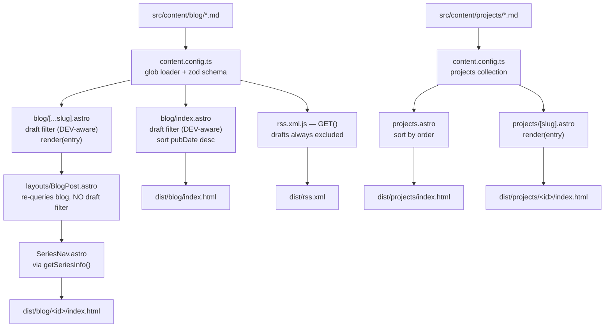

# Pieter de Jong - Personal website

[](https://github.com/pieteradejong/astropieter/actions/workflows/ci.yml) [](https://github.com/pieteradejong/astropieter/actions/workflows/security.yml) [](https://github.com/pieteradejong/astropieter/actions/workflows/link-report.yml)

Live at: https://padj.vercel.app/

**This is my main online presence**, aside from [my LinkedIn](https://www.linkedin.com/in/pieteradejong/) and [my GitHub](https://github.com/pieteradejong). The Internet is a large place, and standing out is both critical and hard. This is where I aim to do so.

# Goals
* Marketing: put myself out there.
* Connect: Find like-minded, share ideas, potentially work together, etc.

# Website 'Table of contents':

* Blog - I like to write
* About Me - Personal background, history, what sets me apart from the crowd.
* Reading: I love to read, and seek out fellow readers.
* Contact: self-evident.


# Maintenance / deployment
Built with [Astro](https://astro.build) and hosted on [Vercel](https://vercel.com). `npm run dev` serves the site on `localhost` with live reload; pushing to `main` deploys it. See [Deployment](#deployment).

# TODO 
Stuff I would like to add in the future:
* Top priorities: content, quality, and loading speed.
* auto translate to any language, especially Spanish and Dutch. Classic Latin and Classic Greek would be cool too.
* Low-friction contact methods.
* Inline programming code, e.g. `Python`.
* If/when my content becomes good enough, a micro-payment "tip jar".

# Astro Blog

A modern, fast blog built with Astro.js featuring static search capabilities.

## Features

- 🚀 Built with Astro.js for optimal performance
- 📝 Markdown and MDX support
- 🔍 Static search functionality with Pagefind
- 📱 Responsive design
- 🎨 Clean, professional styling
- 📊 LaTeX support for mathematical content
- 🔄 Easy deployment with included scripts

## Quick Start

1. Clone the repository:
```bash
git clone https://github.com/yourusername/astropieter.git
cd astropieter
```

2. Run the initialization script (checks Node ≥ 22.12, `npm ci`, creates `.env` from
   `.env.example`, looks for a Chrome for the browser tests):
```bash
./init.sh
```

3. Start the development server:
```bash
./run.sh            # dev server on http://localhost:4321/, also reachable from a phone on the same Wi-Fi
./run.sh build      # production build
./run.sh preview    # serve dist/
./run.sh stop       # stop the background dev server
```

## Local Development

To run the site locally:

1. Make sure you have Node.js 22.12+ installed (required by Astro 6+; see [Upgrade Reqs](#upgrade-reqs))
2. Clone the repository and navigate to it:
```bash
git clone https://github.com/yourusername/astropieter.git
cd astropieter
```

3. Install dependencies:
```bash
npm install
```

4. Start the development server:
```bash
npm run dev
```

The site will be available at `http://localhost:4321` (or another port if 4321 is in use).

Unlisted pages, built but kept out of the nav and the sitemap: `/qr/` (a QR code for the site, to
open on a phone and hold up; the SVG is `public/qr.svg`, regenerate it with
`qrencode -t SVG -l M -m 2 -o public/qr.svg '<site url>'` if the domain changes), `/press/` and
`/software/` (unfinished).

Key development commands:
- `npm run dev` - Start development server with hot reloading (Astro 7 runs this as a background daemon — manage it with `npx astro dev status` / `stop` / `logs`)
- `npm run build` - Build the site for production
- `npm run preview` - Preview the production build locally

## Testing

Run `./test.sh` before deploying (`./test.sh --offline` skips the network checks). It covers dependency health (exact pins, installed = declared, no unused packages), the production build, drafts and RSS, KaTeX, theme and contrast, accessibility, SEO, outbound links (project links plus every link on `/reading/` and `/about/`), and a dev-server smoke test. Exits non-zero on any failure. Details: `docs/TESTING.md`.

Its browser section runs two Playwright suites (headless, installed Chrome) against the dev server. `tests/content.spec.ts`: every Markdown/GFM construct, LaTeX in `.md` and `.mdx`, the KaTeX stylesheet and fonts actually applied, and every blog post free of math errors, leaked LaTeX and console errors; its fixtures are draft posts (`src/content/blog/test-fixture-*`), never built for production. `tests/mobile.spec.ts`: every route at 320, 375 and 414px with no horizontal overflow, no text under 12px, ≥44px nav/footer/form controls, ≥16px inputs, the hamburger menu, the horizontal nav at 768–1024px, and the Terra demo's phone layout. To run the browser tests alone, with a dev server already up:

```bash
BASE_URL=http://localhost:4321 npx playwright test
```

Playwright uses the installed Chrome (set `CHROME_PATH` if it is somewhere unusual); no browser download is needed.

## Writing LaTeX

Inline math: `$E = mc^2$`. Display math needs the `$$` on lines of their own:

```markdown
$$
\int_{-\infty}^{\infty} e^{-x^2}\,dx = \sqrt{\pi}
$$
```

`$$x$$` on a single line renders as *inline* math; `test.sh` fails on it. A literal dollar sign is `\$`. Math works the same in `.mdx` posts.

How it works: `remark-math` finds the math, `rehype-katex` renders it with its own bundled `katex`, and `BaseHead.astro` loads the matching KaTeX stylesheet from jsDelivr. When `rehype-katex` moves to a new katex, `test.sh` fails until the stylesheet URL and its `integrity` hash are updated to match.

## Deployment

Push to `main`: Vercel builds and publishes the site to https://padj.vercel.app. There is no deploy script. Vercel does not run the tests, so run `./test.sh` before pushing. On GitHub, `.github/workflows/ci.yml` then runs `./test.sh --offline` on the push (the **site / tests** check) and, once Vercel reports the production deployment, `./test.sh --live https://padj.vercel.app` against what is actually served (the **site / live** check). Both must be green for the site to count as working. Rollback, configuration and plan limits: `DEPLOYMENT.md`.

## Project Structure

```
.
├── src/
│   ├── components/       # Reusable components
│   ├── content/          # Content collections: blog/ and projects/ (markdown/MDX)
│   ├── content.config.ts # Content collection schemas (Content Layer API)
│   ├── layouts/          # Page layouts
│   ├── pages/            # Astro pages (qr.astro, press.astro, software.astro are unlisted)
│   └── styles/           # Global styles and the pub-* design tokens
├── public/               # Static assets (qr.svg, terra/ standalone demo)
├── docs/                 # TESTING.md, CONTENT-REVIEW.md (open content items)
├── init.sh               # First-time setup
├── run.sh                # dev | build | preview | stop
├── test.sh               # Comprehensive pre-deploy test suite
├── tests/                # Playwright: content.spec.ts, mobile.spec.ts
├── playwright.config.ts  # Playwright config (uses installed Chrome)
├── CHANGELOG.md          # What changed, per session
├── DEPLOYMENT.md         # Vercel hosting, rollback, limits
└── DECISIONS.md          # Decision log (why Vercel, …)
```

## Content Pipeline

How a markdown file becomes a page. `entry.id` is the slugified filename, so `LaTeX_test.md` becomes `/blog/latex_test/`.



### Known inconsistency: draft filtering

The `draft` flag is honoured in three different ways, which is worth knowing before adding a fourth consumer:

| Consumer | Behaviour |
|---|---|
| `blog/index.astro`, `blog/[...slug].astro` | DEV-aware — drafts visible in `astro dev`, excluded from the production build |
| `rss.xml.js` | always excludes drafts, in dev and prod alike |
| `layouts/BlogPost.astro` | **no draft filter at all** |

`BlogPost.astro` re-queries the whole `blog` collection to build series navigation, so `SeriesNav` prev/next links can point at draft posts that have no generated page in production. Not currently fixed — recorded here so it isn't rediscovered from scratch.

## Upgrade Reqs

Requirements/notes for upgrading Astro across major versions (last reviewed: Astro 5 → 7, Aug 2026):

- **Node 22.12+** required starting in Astro v6 (drops Node 18/20 support)
- **Env vars**: `import.meta.env` values are always inlined and no longer type-coerced (Astro v6); private env vars must be read via `process.env` explicitly
- **Images**: default image service crops by default and never upscales (Astro v6)
- **Routing**: file-extension endpoints can't be accessed with a trailing slash (Astro v6)
- **Removed in v6**: legacy Content Collections API (v2 format), `Astro.glob()`, `<ViewTransitions />` (use `<ClientRouter />`), CJS config files
- **Deprecated in v6**: `Astro` global in `getStaticPaths()`, `astro:schema` import (use `astro/zod`), session driver strings
- **Dependency bumps in v6**: Vite 7, Zod 4 (`z.email()` instead of `z.string().email()`), Shiki 4
- **New Rust-based compiler in v7**: stricter HTML — unclosed tags now error, invalid HTML no longer auto-corrected. Audit `.md`/`.mdx` content for malformed tags.
- **Whitespace in v7**: `compressHTML` default changed from `true` to `'jsx'`, affecting spacing between inline elements
- **Vite 8** upgrade in v7 — check custom plugins/config for compatibility
- **Markdown in v7**: new "Sätteri" pipeline replaces remark/rehype by default. This project uses `remark-math` + `rehype-katex` for LaTeX — install `@astrojs/markdown-remark` to keep the remark/rehype pipeline working
- **`@astrojs/db` removed** entirely in v7 (not used in this project)

Recommended upgrade path: run `npx @astrojs/upgrade` to update Astro and official integrations together, then fix any compiler errors surfaced during build.

## Changelog

See [`CHANGELOG.md`](CHANGELOG.md).

## Customization

### Styling

All styles use CSS variables defined in `src/styles/global.css`. Key variables:
- `--accent`: Primary accent color (used for links)
- `--non-link-text`: Color for non-interactive text
- `--card-bg`: Background color for cards
- `--border`: Border color
- Breakpoints: one phone breakpoint, `max-width: 767px` (and `min-width: 768px` for the horizontal nav). `--spacing-unit` scales the gutters, so pages rarely need their own media queries.

## Contributing

1. Fork the repository
2. Create your feature branch
3. Commit your changes
4. Push to the branch
5. Create a Pull Request

## License

MIT License - see LICENSE file for details
